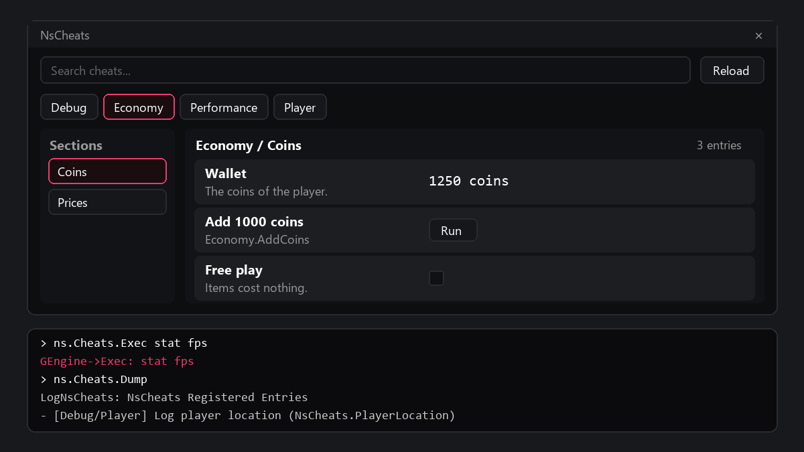

# NsCheats User Guide

## Purpose

NsCheats is a registry of debug cheats with a built-in window. Game systems register buttons, toggles, number fields, text fields, pickers, and debug text. A developer opens the window during play and uses the cheats.

NsCheats is for development builds. In a Shipping build, the registry, the window, and the console commands compile out, so a cheat never runs. Do not use NsCheats for player-facing features or settings.

[](Showcase/CheatWindow.html)

## Setup

1. Copy the `NsCheats` folder into the `Plugins` folder of your project.
2. Enable the plugin in **Edit > Plugins**, or add `NsCheats` to the `Plugins` list of the `.uproject` file.
3. For C++, add `"NsCheatsRuntime"` to the module dependencies in `Build.cs`.
4. Generate the project files and build.

The plugin adds `UNsCheatsSubsystem`, a game instance subsystem. It has no project settings.

## Quick Start

### Blueprint

1. Open an actor Blueprint.
2. On `Event BeginPlay`, get the NsCheats subsystem. Type `Ns Cheats Subsystem` in the node search.
3. From the subsystem, call `Register Button Cheat`.
4. Set **Id** to `MyGame.Hello`, **Tab** to `MyGame`, **Category** to `Test`, and **Display Name** to `Say hello`.
5. Connect **Self** to **Owner**.
6. Drag from **Execute Delegate** and add a custom event. Add a `Print String` node to that event.
7. Place the actor in a level and start Play In Editor (PIE).
8. Open the console and run `ns.Cheats.Toggle`.
9. In the window, click the `MyGame` tab, then click **Run** on `Say hello`.

### C++

1. Implement `INsCheatProviderInterface` on a game instance subsystem.

```cpp
// MyEconomySubsystem.h
#pragma once

#include "Subsystems/GameInstanceSubsystem.h"
#include "NsCheatProviderInterface.h"
#include "MyEconomySubsystem.generated.h"

UCLASS()
class UMyEconomySubsystem : public UGameInstanceSubsystem, public INsCheatProviderInterface
{
    GENERATED_BODY()

public:
    virtual void Initialize(FSubsystemCollectionBase& Collection) override;
    virtual void RegisterCheats_Implementation(UNsCheatsSubsystem* CheatsSubsystem) override;

private:
    void AddDebugCoins();
    bool bFreePlay = false;
};
```

2. Start the NsCheats subsystem first, then register the provider. Then register the cheats with the builder.

```cpp
// MyEconomySubsystem.cpp
#include "MyEconomySubsystem.h"
#include "NsCheatsSubsystem.h"

void UMyEconomySubsystem::Initialize(FSubsystemCollectionBase& Collection)
{
    Super::Initialize(Collection);
    if (UNsCheatsSubsystem* Cheats = Collection.InitializeDependency<UNsCheatsSubsystem>())
    {
        Cheats->RegisterProvider(this);
    }
}

void UMyEconomySubsystem::RegisterCheats_Implementation(UNsCheatsSubsystem* CheatsSubsystem)
{
    CheatsSubsystem->ForProvider(this, TEXT("Economy"))
        .Section(TEXT("Coins"))
        .Button(TEXT("Economy.AddCoins"), INVTEXT("Add 1000 coins"),
            FNsCheatExecuteDelegate::CreateUObject(this, &UMyEconomySubsystem::AddDebugCoins))
        .Toggle(TEXT("Economy.FreePlay"), INVTEXT("Free play"),
            FNsCheatGetBoolDelegate::CreateLambda([this]() { return bFreePlay; }),
            FNsCheatSetBoolDelegate::CreateLambda([this](bool bValue) { bFreePlay = bValue; }));
}
```

3. Start PIE and run `ns.Cheats.Toggle`.

`RegisterProvider` ignores a provider that it already has, so the call is safe if discovery also finds the subsystem.

## Common Tasks

### Register cheats from an actor or a component

1. Implement `INsCheatProviderInterface` on the actor or the component.
2. In `BeginPlay`, call `RegisterProvider(this)` on the NsCheats subsystem.
3. In `EndPlay`, call `UnregisterProvider(this)`.

### Implement the provider interface in Blueprint

1. Open the Blueprint and click **Class Settings**.
2. In **Interfaces**, add `NsCheatProviderInterface`.
3. Implement the `Register Cheats` event. Call the `Register ... Cheat` nodes on the **Cheats Subsystem** input.
4. On `Event BeginPlay`, call `Register Provider` with **Self**.

### Add a number field

1. C++: call `Float(Id, Label, GetValue, SetValue)` on the builder.
2. Blueprint: call `Register Float Cheat` and bind **Get Delegate** and **Set Delegate**.
3. In the window, type a value and push Enter. The window calls the set delegate and shows the new value.

### Add a text field with an action

1. C++: call `Text(Id, Label, GetValue, SetValue, Execute)` on the builder.
2. Blueprint: call `Register Text Cheat` and bind **Execute Delegate**.
3. In the window, type the text and push Enter. The window calls the set delegate.
4. Click **Run** to call the action.

### Add a picker

1. Give a list of `FNsCheatPickerOption` from the options delegate. Each option has a **Value** (a name) and a **Label** (the text in the dropdown).
2. C++: call `Picker(Id, Label, GetOptions, GetValue, SetValue, Refresh)` on the builder.
3. Blueprint: call `Register Picker Cheat`.
4. In the window, select an option. The window calls the set delegate with the **Value** of that option.
5. If the `Refresh` delegate is bound, the row shows a **Run** button that calls it.

### Add a row of buttons (C++ only)

1. Make a `TArray<FNsCheatInlineAction>`. Give each action an `Id`, a `Label`, and an `ExecuteDelegate`.
2. Call `ButtonRow(Id, Label, Actions)` on the builder.

### Organize entries

1. Set the tab with the `Tab` argument of `ForProvider`, or the **Tab** input of a `Register ... Cheat` node.
2. Set the section with `Section(Name)` on the builder, or the **Category** input of a node.
3. Set `SortOrder` to order entries in one section. A lower value comes first.
4. Give each entry a unique `Id`. Put the system name first, for example `Economy.AddCoins`.

The window sorts tabs and sections by name. In a section, it sorts entries by `SortOrder`, then by label. A new entry with the same `Id` replaces the old entry.

### Find a cheat

1. Open the window with `ns.Cheats.Toggle`.
2. Type in the search box. The search matches the label, description, id, tab, and section, and ignores case.

### Run a cheat from code

1. Call `ExecuteEntry(Id)` on the NsCheats subsystem.
2. Read the return value. It is `true` if the entry has a bound action.

`ExecuteEntry` runs the action of a button, a text field, or a picker. It does not change a toggle, and it does not run the buttons of a `ButtonRow`.

### Remove cheats

1. Call `UnregisterCheatEntry(Id)` to remove one entry.
2. Call `UnregisterCheatsByOwner(Owner)` to remove all entries of one owner.
3. Call `UnregisterProvider(Provider)` to remove a provider and all its entries.

### Run a console command from the window or a script

1. Run `ns.Cheats.Exec <command>`, for example `ns.Cheats.Exec stat fps`.

## Settings

NsCheats has no project settings. These are the values of a new entry.

### Builder (`ForProvider`)

| Setting | Default | Effect |
|---|---|---|
| Tab | `Debug` if the name is empty | The tab of all entries in the chain. |
| Section | `General` | The section of the next entries. An empty name gives `General`. |
| Description | Empty | The text under the label. If it is empty, the window shows the `Id`. |
| SortOrder | `0` | The order in the section. |
| Owner | The `Owner` of `ForProvider` | The entries leave when the owner is destroyed. |

### Blueprint nodes (`Register ... Cheat`)

| Setting | Default | Effect |
|---|---|---|
| **Id** | None | The unique key. An entry with no id is ignored, with a warning. |
| **Tab** | None | The tab. The node uses the value as it is, so set it. |
| **Category** | None | The section. The node uses the value as it is, so set it. |
| **Display Name** | Empty | The label of the row. |
| **Description** | Empty | The text under the label. If it is empty, the window shows the **Id**. |
| **Owner** | None | The entries leave when the owner is destroyed. |
| **Sort Order** | `0` | The order in the section. |

### Window

| Setting | Default | Effect |
|---|---|---|
| Title | `NsCheats` | The title of the window. |
| Size | 760 x 680 | The first client size of the window. |

## Debug

### Console commands

| Command | Effect |
|---|---|
| `ns.Cheats.Open` | Opens the window, or brings it to the front. |
| `ns.Cheats.Close` | Closes the window. |
| `ns.Cheats.Toggle` | Opens or closes the window. |
| `ns.Cheats.Dump` | Logs all entries as `- [Tab/Section] Label (Id)`. |
| `ns.Cheats.Exec <command>` | Runs a console command in the game world. |

### Built-in entries

| Tab | Section | Entry | Effect |
|---|---|---|---|
| `Debug` | `Registry` | Dump registered cheats | Logs all entries. |
| `Debug` | `Player` | Log player location | Logs the location and rotation of the pawn of the first player controller. |
| `Performance` | `Stats` | Toggle stat fps | Runs `stat fps`. |
| `Performance` | `Stats` | Toggle stat unit | Runs `stat unit`. |

### Log

The log category is `LogNsCheats`. The window has a **Reload** button that builds all rows again.

## Troubleshooting

| Problem | Cause | Fix |
|---|---|---|
| The cheats of a subsystem do not show. | Discovery runs one time, when the NsCheats subsystem starts. Subsystems that start later are not found. | Call `RegisterProvider(this)` from the subsystem. See Quick Start. |
| The cheats of a world subsystem do not show after a map change. | Discovery looks only at the world that exists when the NsCheats subsystem starts. | Call `RegisterProvider(this)` from the world subsystem. |
| A Blueprint entry is in a tab named `None`. | The **Tab** or **Category** input is empty. | Set **Tab** and **Category** on the node. |
| The log shows `Ignoring cheat entry with empty Id.` | The entry has no `Id`. | Give the entry an `Id`. |
| The log shows `Usage: ns.Cheats.Exec <Command>`. | The command has no argument, or there is no world. | Give a command, for example `ns.Cheats.Exec stat fps`. |
| A debug text row shows an old value. | Debug text is read when the window builds its rows. | Click **Reload**. |
| A cheat replaces another cheat. | Two entries use the same `Id`. | Give each entry a unique `Id`. |
| The console commands are not found in a Shipping build. | The commands compile out in Shipping. | Use a Development or DebugGame build. |

## Limits

- The window is a separate Slate window, not a widget in the game viewport.
- The plugin does not replicate. A cheat runs on the machine where you use it. A server cheat needs a server RPC in your game code.
- `ButtonRow` has no Blueprint registration function.
- `ExecuteEntry` does not run a `ButtonRow` button or change a toggle.
- With more than one PIE client, the console commands control the window of the first game instance that started.
